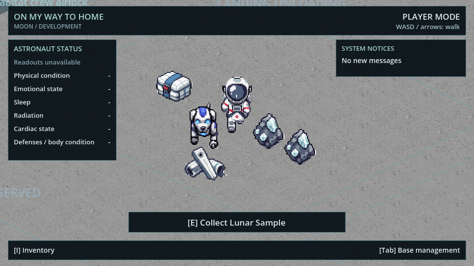

# On My Way to Home

A fully **2D isometric pixel-art** exploration and resource-management prototype built with **Godot 4.7.2** and GDScript.

Explore a small lunar region with **Chiwis**, your robotic companion. Collect a sample, enter the research outpost through its airlock, and examine it at the science station.

**Development status:** A playable Moon tutorial with a compact modular outpost, nine furnished rooms, inventory, utilities and greenhouse routines. Main Menu → New Game starts a fresh session. Windowed and borderless fullscreen modes use a 960×540 logical resolution.

## Prototype screenshots

These are historical 960×540 captures. Current gameplay captures are listed in the [release cleanup report](docs/phase_0_9_2_release_cleanup.md).

## What currently works

- A 40×40 logical Moon map with finished 64×32 isometric regolith tiles.
- Eight-direction astronaut walking/running and autonomous Chiwis walking/catch-up running.
- Player and Base Management cameras with bounded views and mode switching.
- Nearby interaction, stackable items and a 20-slot runtime inventory.
- Static EVA perimeter warnings and blocked tutorial boundaries.
- A visible modular outpost and nine accessible furnished rooms through the existing interlocked airlock.
- A powered sample-examination routine.
- Prototype utilities with finite resource stores, battery/power accounting and alarms.
- Two resource-dependent growing trays and lightweight daily activities.

## Controls

| Input | Action |
| --- | --- |
| WASD / arrow keys | Walk in Player Mode; pan in Base Management Mode |
| Hold Shift + movement | Run in Player Mode; configurable in Settings → Controls |
| F11 / Alt+Enter | Toggle borderless fullscreen and restore the previous window |
| Tab | Switch camera/gameplay mode |
| Mouse wheel | Management-camera zoom |
| E / left click | Interact with the nearest valid object |
| I | Open/close inventory in Player Mode |
| Esc | Close the current modal panel; interrupt an unfinished routine |

## Try the existing demo route

1. Run the project normally (F5), choose **New Game**, then collect the nearby Lunar Sample beside the lander with E; inspect it with I.
2. Try Tab and the management camera, then return to Player Mode.
3. Follow the base exterior to the crew airlock beside the central habitat.
4. Seal the outer hatch, inspect suit/dust seals, match habitat pressure, then enter through the inner hatch.
5. Go Equipment lock → Hub → Health/science.
6. Use the Science station, choose **Examine sample**, and keep its panel open until completion. The sample remains in inventory.

The existing mission card tracks collection, entry and powered examination. Other furnished rooms include living/galley/hygiene, engineering, cargo, greenhouse and shelter. The airlock remains an interlocked presentation abstraction, not a gas-volume solver.

## Validation

On Windows, use PowerShell with the configured Godot executable:

~~~powershell
$env:GODOT_BIN = 'C:\path\to\Godot_v4.7.2-stable_win64.exe'
./tests/validate.ps1 -IncludeRendering
./tests/validate_clean_start.ps1
~~~

Optional data/release checks use Node.js:

~~~text
node tools/habitat/validate_layout.mjs
node tools/research/validate_science_catalog.mjs --self-test
node tools/release/audit_repository.mjs
node tools/release/public_manifest.mjs
~~~

Outputs and isolated profiles go under ignored `tests/output/`. Local `.vscode/` settings are ignored; public users should use `GODOT_BIN` or the validator's `-GodotPath` argument. Recreating character exports additionally requires the separately supplied original PXO files and an installed Pixelorama resource pack; see [asset workflow](docs/phase_0_6_report.md).

## Tested environment and limitations

Validation has run on Windows with Godot 4.7.2's Compatibility renderer and an NVIDIA GeForce RTX 3050 Laptop GPU at the 960×540 logical resolution. This is a **tested development environment**, not a minimum hardware requirement or exported-build compatibility claim.

Windows export and clean-machine release testing remain separate work. Disk save/load and campaign progression are not available. Some exterior socket and end-cap facings remain cosmetic limitations. Detailed medicine and survival, other planets, multiplayer and audio are outside the current tutorial. Development utility fault controls require release gating.

## Repository map

| Path | Contents |
| --- | --- |
| `project.godot`, `scenes/`, `scripts/`, `resources/` | Godot project and existing gameplay |
| `assets/` | Runtime textures and preserved source/provenance |
| `art/` | Locked standards, intake manifests and development briefs |
| `docs/` | Design, science references, phase reports and verified screenshots |
| `tests/`, `tools/` | Regression suites and reproducible development tools |
| `builds/windows/` | Ignored future executable staging; never source history |

The configured entry is `scenes/app_root.tscn`. Its existing New Game button calls `GameEntry.new_game()` to construct the reusable Main session; AppRoot owns attachment and teardown. The base is part of that production session, with no special preview scene required.

## Credits and publication status

See [CREDITS.md](CREDITS.md), [third-party/licensing review](docs/THIRD_PARTY_REVIEW.md), [CHANGELOG.md](CHANGELOG.md), and [cleanup report](docs/DEMO_GITHUB_CLEANUP_REPORT.md).

No project license has been selected, and no LICENSE file is supplied. Do not infer that the project's artwork or source is licensed under Godot's MIT license. Source/art redistribution clearance and final public author names remain publisher decisions.

NASA publications inform the research documentation.
**This independent game is not sponsored, approved or endorsed by NASA.**
No NASA affiliation or hardware qualification is claimed.
This game is part of **NASA App Challenge 2026**.

## AI assistance

Development includes code and documentation assistance from OpenAI Codex and artwork produced with PixelLab.ai. Character artwork and animations were made by hand in Pixelorama. Asset provenance and tool credits are recorded in [CREDITS.md](CREDITS.md) and the import manifests.

