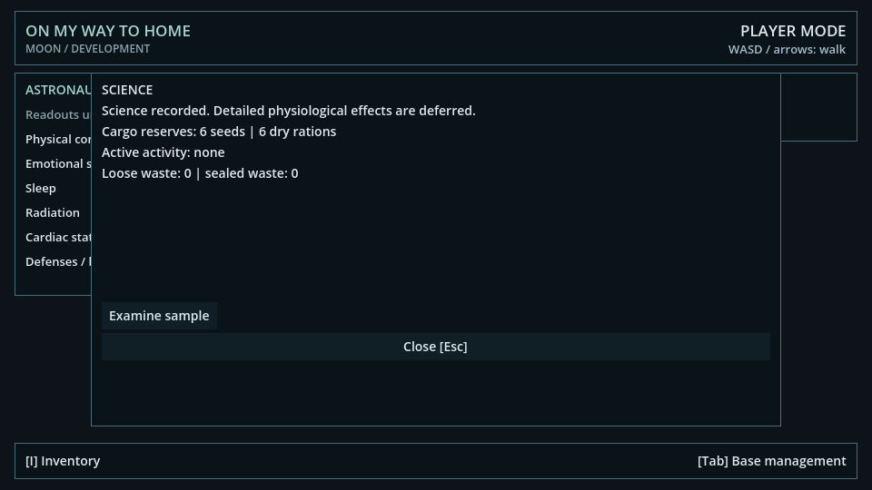

# On My Way to Home

A fully **2D isometric pixel-art** exploration and resource-management prototype built with **Godot 4.7.2** and GDScript.

One astronaut arrives on the Moon with **Chiwis**, a robotic companion, you a small lunar region, bring a sample into the research outpost, and record a powered science examination, you as the player have to find and unlock the data of the nasa to discover new things that will help you in your research.

**Development status:** implementation through Phase 0.8E2, a tested  demo route, startup stabilization, and a local Windows x64 candidate.

## Prototype screenshots

Existing 960×540 gameplay captures; development UI and placeholder interiors are visible.

## What currently works

- A 40×40 logical Moon map with finished 64×32 isometric regolith tiles.
- Eight-direction astronaut walking and autonomous Chiwis following.
- Player and Base Management cameras with bounded views and mode switching.
- Nearby interaction, stackable items and a 20-slot runtime inventory.
- Static EVA perimeter warnings and blocked tutorial boundaries.
- Nine accessible placeholder interior rooms and an interlocked airlock flow.
- A powered sample-examination routine.
- Prototype utilities with finite resource stores, battery/power accounting and alarms.
- Two resource-dependent growing trays and lightweight daily activities.

## Controls

| Input | Action |
| --- | --- |
| WASD / arrow keys | Walk in Player Mode; pan in Base Management Mode |
| Tab | Switch camera/gameplay mode |
| Mouse wheel | Management-camera zoom |
| E / left click | Interact with the nearest valid object |
| I | Open/close inventory in Player Mode |
| Esc | Close the current modal panel; interrupt an unfinished routine |

## Try the existing demo route

1. Collect the nearby Lunar Sample with E; inspect it with I.
2. Try Tab and the management camera, then return to Player Mode.
3. Walk northwest to the habitat entry at logical cell (-8, 0).
4. Seal the outer hatch, inspect suit/dust seals, match habitat pressure, then enter through the inner hatch.
5. Go Equipment lock → Hub → Health/science.
6. Use the Science station, choose **Examine sample**, and keep its panel open until completion. The sample remains in inventory.

This route works; an objective tracker/completion screen has not yet been assembled. The airlock is an interlocked presentation abstraction, not a gas-volume solver.

## Validation

On Windows, use PowerShell with the configured Godot executable:

~~~powershell
$env:GODOT_BIN = 'C:\path\to\Godot_v4.7.2-stable_win64.exe'
./tests/validate.ps1 -IncludeRendering
./tests/validate_clean_start.ps1
~~~

Optional data/release checks use Node.js:

~~~text
node tools/habitat/validate_layout.mjs
node tools/research/validate_science_catalog.mjs --self-test
node tools/release/audit_repository.mjs
node tools/release/public_manifest.mjs
~~~

Outputs and isolated profiles go under ignored `tests/output/`. Local `.vscode/` settings are ignored; public users should use `GODOT_BIN` or the validator's `-GodotPath` argument. Recreating character exports additionally requires the separately supplied original PXO files and an installed Pixelorama resource pack; see [asset workflow](docs/phase_0_6_report.md).

## Tested environment and limitations

Validation has run on Windows with Godot 4.7.2's Compatibility renderer and an NVIDIA GeForce RTX 3050 Laptop GPU at the 960×540 logical resolution. This is a **tested development environment**, not a minimum hardware requirement or exported-build compatibility claim.

There is no exported Windows build, clean-machine installation test, packaged demo menu, disk save/load or campaign progression yet. Interiors and much UI remain placeholders. Exterior base/lander asset packs are preserved but not assembled into the production map. Detailed medicine/survival, Mars, multiplayer and audio are outside the frozen demo scope. Development utility fault/scenario controls require release gating.

## Repository map

| Path | Contents |
| --- | --- |
| `project.godot`, `scenes/`, `scripts/`, `resources/` | Godot project and existing gameplay |
| `assets/` | Runtime textures and preserved source/provenance |
| `art/` | Locked standards, intake manifests and development briefs |
| `docs/` | Design, science references, phase reports and verified screenshots |
| `tests/`, `tools/` | Regression suites and reproducible development tools |
| `builds/windows/` | Ignored future executable staging; never source history |

The existing Main scene remains the startup entry. `GameEntry.new_game()` constructs a fresh session for a future menu; the caller owns attachment and teardown.

## Credits and publication status

See [CREDITS.md](CREDITS.md), [third-party/licensing review](docs/THIRD_PARTY_REVIEW.md), [CHANGELOG.md](CHANGELOG.md), and [cleanup report](docs/DEMO_GITHUB_CLEANUP_REPORT.md).

No project license has been selected, and no LICENSE file is supplied. Do not infer that the project's artwork or source is licensed under Godot's MIT license. Source/art redistribution clearance and final public author names remain publisher decisions.

NASA publications inform the research documentation. **This independent game is not sponsored, approved or endorsed by NASA.** No NASA affiliation or hardware qualification is claimed.

