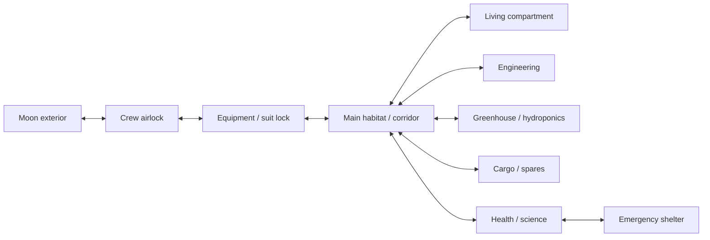

# Phase 0.8D - Moon Habitat and Interior Architecture

Implemented a fictional future Moon research outpost using **nine compact, explorable native 2D compartment scenes**. Together they provide all sixteen requested facility groups, represented by eighteen inspectable stations because equipment/crew locks and suit/dust stations have distinct roles. The main scene starts on the existing Moon map. Walk northwest from spawn to the **Habitat crew airlock** marker at logical cell **(-8, 0)** and use the existing E interaction.

These are development cutaways and placeholder facilities. No claim is made that NASA operates this exact base or that its dimensions, one-human staffing, shielding, systems capacity or procedures have been certified. No audio, PixelLab generation, final artwork, Mars map or Phase 0.8E1 is included.

## Compact layout and facility coverage

The layout is data-driven in [habitat_layout.json](../resources/data/habitat_layout.json). Each compartment uses the same reusable [habitat_room.tscn](../scenes/habitat/habitat_room.tscn), its own sparse logical floor and its own retained state. Rooms range from **6x6 to 8x9 logical cells including their wall ring**. Across all rooms there are **260 walkable floor cells**, with clear routes around cabinets and partitions. Logical cells remain native **64x32** diamonds; no conversion into square meters, human-rated volume or certified capacity is asserted.



| Requested facility | Accessible compartment / treatment |
| --- | --- |
| 1. Main habitat / central corridor | Hub; common circulation and orientation station |
| 2. Equipment lock and crew airlock | Separate equipment_lock and crew_airlock rooms, separated by an inner pressure boundary |
| 3. Suit maintenance / dust removal | Separate inspectable stations in equipment lock; crew-lock suit/dust inspection acknowledgment before occupied cycling |
| 4. Sleeping quarters | Living module, personal-rest station |
| 5. Galley / food storage | Living module, separate station from hygiene |
| 6. Hygiene / waste compartment | Partitioned living-module alcove, separated from the galley by a solid privacy wall |
| 7. Greenhouse / hydroponics lab | Separate greenhouse room with cultivation-bed placeholders |
| 8. ECLSS | Engineering equipment station |
| 9. Water processing / storage | Engineering water station |
| 10. Power distribution / engineering | Engineering power station |
| 11. Medical / health monitoring | Health/science module, medical station |
| 12. Exercise / rehabilitation | Health/science module, exercise station |
| 13. Mission operations / communications | Hub operations station |
| 14. Science lab / sample storage | Partitioned health/science alcove; sample handling remains an architectural reservation, not a processing system |
| 15. Cargo / spare parts | Separate storage compartment |
| 16. Protected emergency shelter | Dedicated room off health/science, within the assumed pressurized domain |

Sharing compact modules avoids one enormous hall for every function. The hygiene and sample alcoves have interior partitions; storage and crop research have separate rooms. Stations can be approached, inspected and revisited. Inspection records are persistent development state, not evidence of operating life-support machinery, clinical diagnosis, food production or equipment repair.

The exterior remains the Phase 0.8B tutorial terrain and reservations, with a placeholder airlock entry. Interior cutaways are separate scene spaces linked by door metadata; their aggregate floor area is not silently assigned as a certified exterior building footprint or a new construction/occupancy map. No finished exterior art is integrated in this phase.

## Engineering references and scientific boundaries

Read the Science Bible, Scientific Gameplay Rules and NASA Technology Catalog before implementation. Research references include **NASA-HAB-MOONBASE**, **NASA-AIRLOCK-QUEST**, **NASA-GAS-CONTROL**, **NASA-ANALOG-CHAPEA**, **NASA-WATER-WPA**, **NASA-FOOD-PACKAGED**, **NASA-PLANT-APH**, **NASA-EXERCISE-ARED**, **NASA-MED-MONITOR**, **NASA-SAMPLE-PROVENANCE** and **NASA-RADIATION-SHELTER**.

- Quest provides the inspiration for separate equipment/suit-support and crew-exit compartments. The connecting inner boundary and exterior boundary are distinct. This uses [NASA's Quest description](https://www.nasa.gov/international-space-station/quest-airlock/) and its historical [ISS reference guide](https://www.nasa.gov/wp-content/uploads/2017/09/np-2015-05-022-jsc-iss-guide-2015-update-111015-508c.pdf); ISS heritage does not establish lunar dust qualification.
- ISS atmosphere and water systems motivate separate ECLSS, processing/storage and utility areas. They are dependencies, not decorative furniture that automatically generates resources. See [NASA ECLSS](https://www.nasa.gov/reference/environmental-control-and-life-support-systems-eclss/).
- [Moon Base systems](https://www.nasa.gov/moonbase-systems/) is future habitation/power/logistics architecture, not evidence of this installed lunar settlement.
- [CHAPEA](https://www.nasa.gov/humans-in-space/chapea/about-chapea/) motivates distinct sleep, food, hygiene, work, medical, fitness and crop-research spaces. It is an Earth analog with a different crew configuration; neither its area nor staffing is copied as validation for this one-human game. Its older schedule text is not used to override the research registry's later Mission-2 completion evidence.

The shelter is a designated protected refuge with compartment walls/door routing, not a quantified radiation shield or a guarantee against injury. Crop equipment does not imply complete food independence. Medical/exercise stations do not diagnose or cure conditions. Room labels and inspection text stay separate from NASA citations in the research registry; no citations are injected into ordinary item descriptions. No research status, TRL, numerical medical threshold or environmental simulation was changed.

## Floor, walls, doors and navigation

`HabitatRoomRegion` creates sparse interior floor cells while excluding wall rings, cabinets and privacy partitions. `HabitatRoom` builds native isometric TileMapLayer floors using transient **64x32** placeholder ImageTextures at unit scale, nearest filtering and no mipmaps. Floor layer alignment remains **(-32, -16)**. No PNG is generated, resized, trimmed or imported. Placeholder provenance and dimensions are recorded in [habitat_interior.json](../art/placeholders/habitat_interior.json).

The room's StaticBody2D contains ground-diamond CollisionPolygon2D shapes for excluded cells. The same exclusions drive the existing full-foot TerrainWalkability and companion route planner, so visible walls/cabinets agree with navigation. Cutaway wall heights are presentation only. Floors use no per-tile nodes or per-frame rebuilds. Front walls are deliberately transparent low cutaways to keep the actor readable.

Door actions use the existing interactable detector, range, nearest-target selection, terrain line check and remappable primary interaction. Internal traversal stages the pair just inside the reciprocal doorway. Explicit surface-ingress anchors place them by the crew-lock controls. Ordinary compartment doors represent closed hatches that open for the committed transfer and close afterward; crossing a threshold is an E-driven room-scene transition, not seamless walking between one continuous floor map.

The director requires a nearby Chiwis with a traversable route to the hatch before accepting non-station actions. Room-to-room travel stages the same pair through the hatch; it does not spawn another actor or grant unrestricted robot teleportation through invalid terrain. Local autonomous following still uses existing physics and navigation inside each active room.

## Airlock flow

`HabitatAirlock` owns discrete **VACUUM**, **PRESSURIZED** and **CYCLING** states plus independent inner/outer hatch and inspection flags. It contains no gas mass, mixture, leak, breathing or thermal model. The configurable **one-second** cycle is a presentation delay, not a real pressure-control or decompression procedure.

Ingress:

1. Use the exterior crew-airlock marker. If the empty chamber has a different pressure state, it is matched to exterior vacuum with both hatches sealed.
2. The outer hatch opens and the pair enters the crew lock. The inner hatch remains locked. Use the **Close outer hatch** control.
3. Approach **Inspect suit / dust seals** and acknowledge the inspection. This is a tutorial acknowledgment, not an equipment-condition simulation.
4. Use **Cycle pressure** to match the assumed habitat pressure state. Both hatches must be sealed; occupied cycles require suit/dust checks.
5. Use **Inner hatch** to enter the equipment lock; it closes behind the pair. Continue through the central-corridor door.

Egress:

1. Return through equipment lock to the crew-airlock door. An empty chamber is matched to the habitat domain before the inner hatch admits the pair, then the inner hatch closes.
2. Fresh suit/dust checks are required for the new EVA; use the inspection control and cycle to the exterior vacuum state.
3. Use **Outer hatch** to open it, then use it again to exit. The outer hatch closes behind the pair.

The inner hatch cannot open at vacuum, the outer hatch cannot open at habitat pressure, neither opens during cycling, and a pressure cycle cannot start with either hatch open. There is no ordinary corridor door to vacuum. Scene links and runtime pressure-domain guards enforce this. The passive habitat status text shows location and, in the crew lock, pressure state, hatch states and inspection status.

## Persistence and transition ownership

`HabitatDirector` retains the exterior and lazily instantiates each visited room once. Inactive spaces are hidden and process-disabled; their collision objects and interactions leave active use. `Interactable.is_available()` now rejects inactive spaces, preventing stale nearby candidates from being selected after a transition.

The existing astronaut, its child RuntimeInventory/InteractionDetector and the existing Chiwis are **reparented**, never duplicated or re-created. Main's actor references remain stable. Terrain walkability, companion planner/target and camera bounds are rebound to the destination. Exterior parent paths are restored on return. Exact prior exterior positions are retained.

Per-room state includes visits, inspected-facility flags and successful door/control-use counters. Airlock state persists in its own session object. The original exterior pickup nodes, quantities and removals persist in the retained world. Item definitions and inventory remain unchanged. No second inventory, registry, scene-owned copy of items or save singleton was added.

`PlayerSession.transition_blocked` provides a shared gate during deferred transfers and asynchronous cycles. It blocks movement, inventory opening and mode changes; Chiwis stops safely during the transaction. Completion/denial restores the existing permissions and neutral-input handoff. Held E does not automatically re-trigger the next room's action. UI keyboard focus and inventory modal state prevent starting a door operation.

Both view settings are saved by location: player zoom, management zoom and continuous management pan. A room's first visit uses the configurable **1x overview** so its cutaway is readable between HUD panels; later visits restore that room's settings. Returning to the Moon restores the saved exterior settings. The optional `center_small_bounds` camera policy pins a compartment smaller than the viewport to its center; its default remains false for existing exterior/standalone rigs. Larger zoomed interiors still use viewport-aware bounds. Exterior EVA warnings are suspended inside without resetting the excursion state and resume on return.

Persistence here means **within the running session across room and camera transitions**. Disk save/load, scene eviction/reconstruction and application-restart persistence remain outside this phase. A new session starts with clean room state.

## Files and validation

Created:

- `scenes/habitat/habitat_room.tscn`.
- `scripts/habitat/habitat_director.gd`, `habitat_airlock.gd`, `habitat_room.gd`, `habitat_room_region.gd`, `habitat_room_state.gd`, `habitat_action.gd` and Godot UID companions.
- `resources/data/habitat_layout.json`, `art/placeholders/habitat_interior.json`.
- `tools/habitat/validate_layout.mjs`, `tests/habitat_test.gd` and its UID, and this report.

Modified the Main scene/composition, the existing interactable/detector/prompt feedback contract, PlayerSession's input gate, EVA-monitor suspension, both camera rigs/shared framing, the UI-foundation system-count assertion, validation runner and additive AGENTS instructions. No unrelated art files, input bindings, inventory implementations, terrain data or TileSet resources were changed.

Reproduce:

```powershell
node tools/habitat/validate_layout.mjs
node tools/research/validate_science_catalog.mjs
./tests/validate.ps1 -IncludeRendering
```

Godot uses the configured **4.7.2.stable.official.ed1daf0bf** executable and the existing project-isolated validation profile. Windows certificate-store read access requires running the engine outside the restricted sandbox, as in earlier phases; all logs/profiles remain under ignored `tests/output`. No Windows trust or renderer configuration is changed.

Final complete-suite validation passed with **0 engine errors and 0 engine warnings**.

| Validation | Result |
| --- | --- |
| Godot import and script syntax | Passed in Godot 4.7.2 |
| Habitat layout JSON / graph | Nine unique compact rooms, eighteen unique stations covering all sixteen groups, valid arrival/action points and door targets; 260 connected floor cells |
| Habitat acceptance | **971 headless checks / 975 graphical checks passed** |
| Airlock | Initial empty-chamber matching, occupied inspection gates, both pressure directions, incompatible hatch denial, open-hatch cycle denial and no simultaneous hatch opening passed |
| Interior movement | All floor cells reachable with complete-foot checks; actual CharacterBody2D collision, real walking input and live Chiwis following around obstacles passed |
| Persistence | Actor/Chiwis/inventory instance IDs, acquired items, exact partial remainder, removed pickups, inspected facilities, visits, door use and per-location camera settings passed |
| Input safety | Reentrant requests, cycle-time mode/inventory blocking, inventory modal, UI focus, management-mode traversal denial and clean handoff passed |
| Moon map / EVA regressions | 9,261 map checks and 405 EVA safety checks passed; original 1,600-cell raster has zero gaps/overlaps |
| Other existing suites | Foundation, isometric fixture, both camera rigs/modes, astronaut, original character/run art, Chiwis, inventory/interactions, props and UI passed |
| Graphical / fullscreen checks | Editor/main, terrain, modes, actors, UI, habitat captures and existing fullscreen checks passed |
| Research registry / documentation | Consistency check passed with zero errors; eight existing scientific evidence-warning lines remain documented separately from engine warnings |

Evidence includes `phase_0_8D_validation.log`, targeted habitat logs and the visually inspected `habitat_airlock.png`, `habitat_hub.png`, `habitat_living.png`, `habitat_shelter.png` under `tests/output`. The first exploration captures exposed HUD occlusion at inherited zoom; the final 1x defaults and passive status display were retested. An initial regression attempt found the historical three-System-node assertion, updated to include the authorized director. Early habitat test failures were corrected by flushing real E-key events and accounting for the extra health-room visit on the shelter return path; no required behavior was removed.

## Manual acceptance

1. From the Moon spawn, walk northwest to the habitat marker and use E. Follow the ingress sequence above. Confirm that an early inner-hatch or pressure-cycle attempt is refused and explained.
2. Walk around each interior, including the hygiene/sample partitions and greenhouse beds. Inspect all stations and return to them; inspection state should remain recorded.
3. Lead Chiwis around cabinets and through each door. A distant or invalidly placed companion should prevent leaving it behind.
4. Open inventory inside, verify acquired items, then close it and switch camera modes. Attempting a door with inventory/focus active or in Base Management Mode must not traverse.
5. Change management zoom/pan in the exterior and an interior. Revisit each and confirm its saved view and the room's clamped bounds.
6. Use the egress sequence. Verify the original actor instances, partial pickup remainders, collected-item removals, inventory and lunar terrain remain intact.

Known limits: placeholder cabinets and station labels stand in for final furniture/equipment; services are inspectable architecture only. Interlocked hatch passages use scene transfers with automatic closure, not animated leaves or a gas-volume solver. The latest-message notification area may replace earlier instructions; persistent crew-lock status and labeled controls remain available. Textual facility/door labels can overlap at unusually large manual zoom values; the 1x initial view and contextual prompt remain the intended overview. Exterior-building placement, complete hull assembly geometry, quantitative shielding/pressure validation, save/load and detailed survival systems are not implemented. No Phase 0.8E1 begins automatically.
